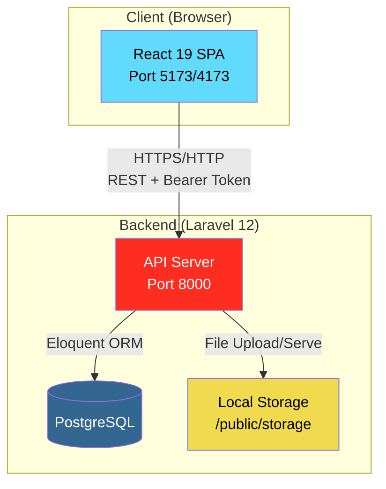
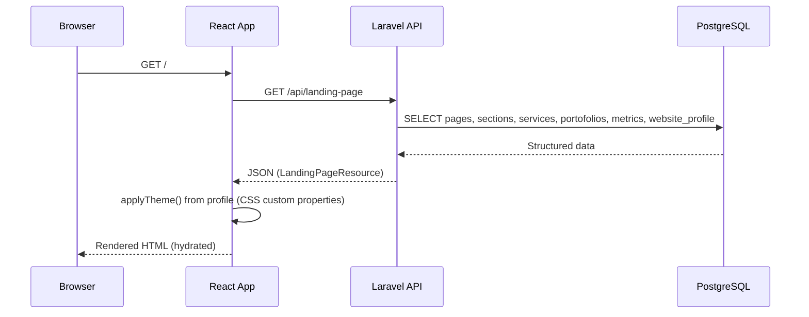
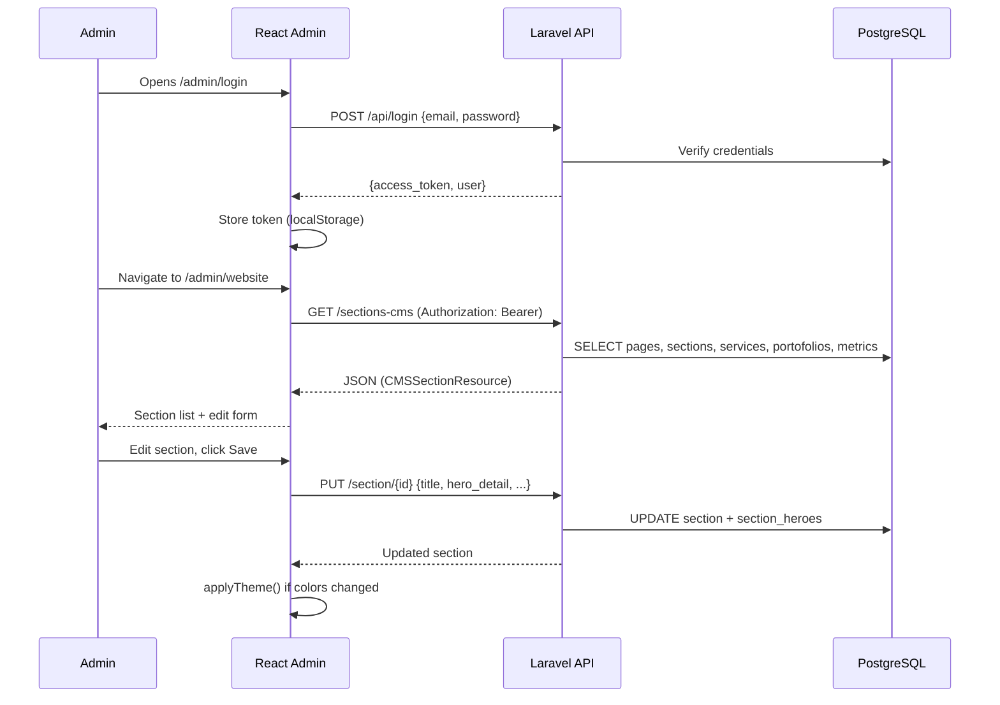
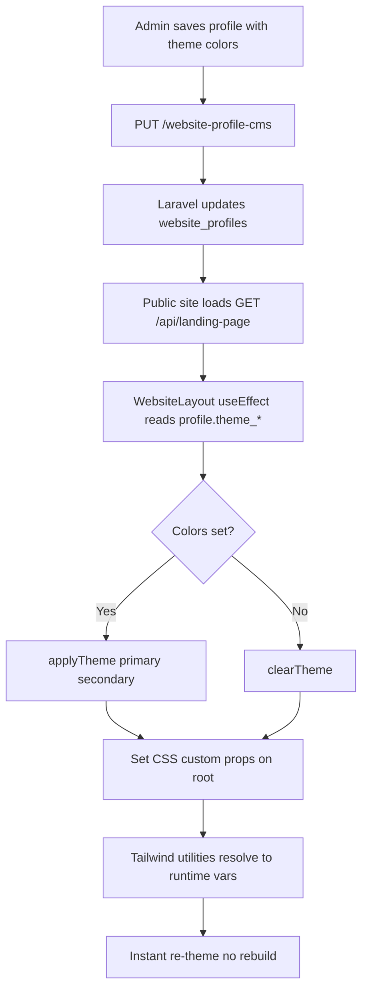
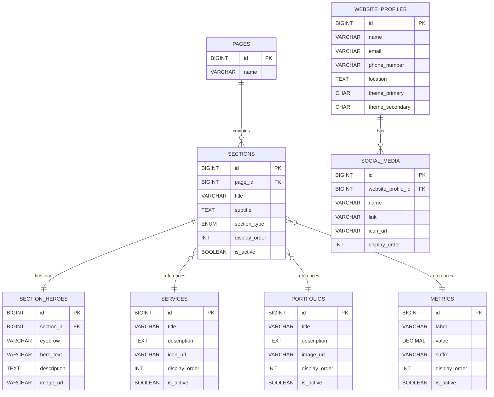
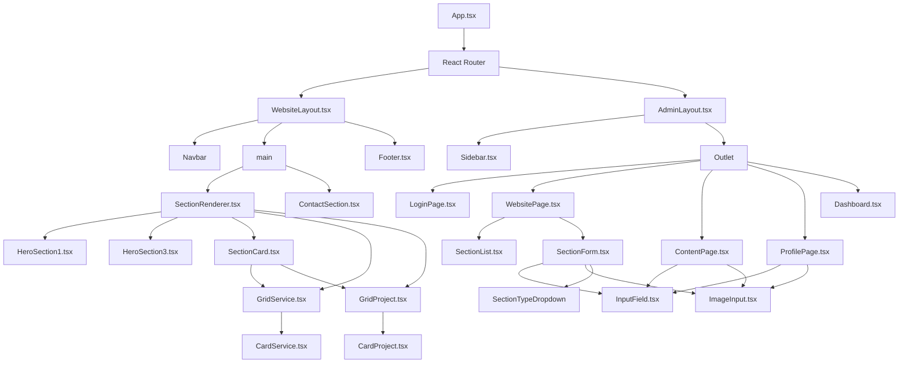
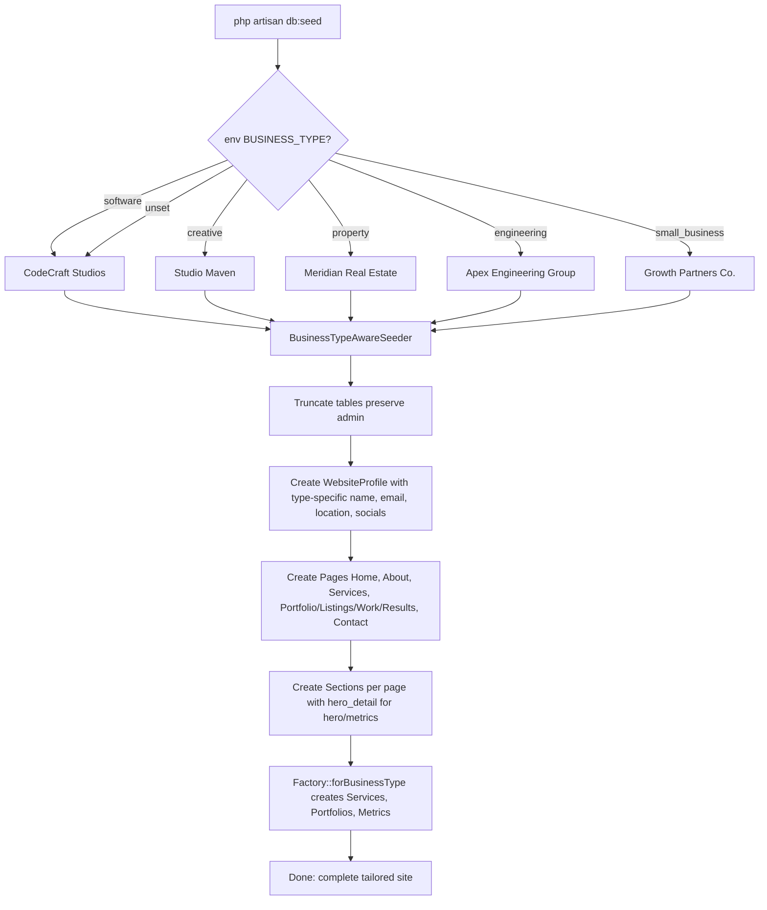

# Your Landing Page + CMS

A portfolio/business landing-page builder: made using **Laravel 12 API** that serves a
section-based public website (the backend), plus a **React 19 admin CMS** to manage all of it (the frontend).
No coding needed to change what's on the page.

```
my-business-cms/
├── be/        Laravel 12 API (PHP 8.2+, Sanctum auth, Postgres/SQLite)
└── fe/        React 19 + Vite + TypeScript + Tailwind v4 SPA
```

## Features

**Public site (`/`)**

- Section-based page: hero, services grid, portfolio grid, metrics, contact
- Content comes entirely from the API (`GET /api/landing-page`)
- Company name, location and social links rendered from the website profile
- Graceful degradation — missing images/icons fall back to styled placeholders

**Admin CMS (`/admin`)**

- **Website** — manage pages & sections, edit hero (eyebrow, image, **heading**), activate/deactivate
- **Content** — CRUD for services, portfolios and metrics
- **Profile** — company name/email/phone/location + social media rows (add/remove/edit) + **brand colors** (primary/secondary)
- **Uploads** — pick an image file for hero/service/portfolio/social; stored via the API
- Login/logout with Sanctum bearer tokens; admin routes are guarded

**Business-type-aware seeding** — one command seeds a complete, realistic site for:

- `software` (CodeCraft Studios) — default
- `creative` (Studio Maven)
- `property` (Meridian Real Estate)
- `engineering` (Apex Engineering Group)
- `small_business` (Growth Partners Co.)

Each type gets tailored copy, services, portfolio projects, metrics, and social links.

**Dynamic theming** — configure primary/secondary brand colors in Profile; both public site and admin CMS apply them instantly without rebuild.

## Quick start

**Backend**

```bash
cd be
composer install
cp .env.example .env
php artisan key:generate          # set DB credentials in .env
php artisan migrate --seed        # seeds the admin account + software demo site
php artisan storage:link          # once, so uploaded images are served
php artisan serve                 # http://127.0.0.1:8000
```

**Frontend** (new terminal)

```bash
cd fe
npm install
cp .env.example .env.local        # points at the backend API
npm run dev                       # http://localhost:5173
```

**Login:** `admin@example.com` / `password`  
Change via `ADMIN_EMAIL` / `ADMIN_PASSWORD` in `be/.env`, then
`php artisan db:seed --class=AdminSeeder`. Public registration is disabled —
the seeded account is the only way into the CMS.

**Seed a different business type:**

```bash
# Creative agency
BUSINESS_TYPE=creative php artisan db:seed

# Real estate
BUSINESS_TYPE=property php artisan db:seed

# Engineering firm
BUSINESS_TYPE=engineering php artisan db:seed

# Small business consultant
BUSINESS_TYPE=small_business php artisan db:seed
```

## Admin config

Single admin account — configured in `be/config/cms.php` via `.env`:

```env
ADMIN_EMAIL=your@domain.com
ADMIN_PASSWORD=your-secure-password
```

## Brand colors (theme)

Set primary/secondary colors in **Admin → Profile → Brand Colors**. Changes apply to both public site and admin CMS immediately via CSS custom properties. No rebuild needed.

Defaults (if not set): primary `#2563eb` (blue), secondary `#0f172a` (navy).

## API overview

| Group      | Endpoints                                                                                                                                                                       |
| ---------- | ------------------------------------------------------------------------------------------------------------------------------------------------------------------------------- |
| Auth       | `POST /api/login`, `POST /api/logout`, `GET /api/user`                                                                                                                          |
| Public     | `GET /api/landing-page`, `/pages`, `/sections`, `/services`, `/portofolios`, `/metrics`, `/section-heroes` (+ `/{id}` variants)                                                 |
| CMS (auth) | create/update/delete for sections, section-heroes, services, portfolios, metrics · `GET /sections-cms`, `/content-cms` · `GET/PUT /website-profile-cms` · `POST/DELETE /upload` |

## Development

```bash
cd fe && npm run build   # tsc (strict) + vite production build
cd fe && npm run lint    # oxlint
cd be && vendor/bin/pint # code style
```

## Technology Stack

### Backend — Laravel 12 API

| Library                     | Purpose        | Example                                                                                        |
| --------------------------- | -------------- | ---------------------------------------------------------------------------------------------- |
| **PHP 8.2+**                | Runtime        | Type hints, readonly properties, attributes                                                    |
| **laravel/framework ^12.0** | Core framework | Routing, Eloquent ORM, validation, auth, queues                                                |
| **laravel/sanctum ^4.0**    | API token auth | `POST /api/login` → returns `access_token`; middleware `auth:sanctum` guards `/admin/*` routes |

---

### Frontend — React 19 + Vite + TypeScript + Tailwind v4 (all added)

| Library                         | Purpose              | Example                                                                |
| ------------------------------- | -------------------- | ---------------------------------------------------------------------- |
| **react ^19.2.8**               | UI library           | Function components, hooks, concurrent features                        |
| **react-dom ^19.2.8**           | DOM renderer         | `createRoot().render(<App />)`                                         |
| **react-router ^7.18.4**        | Client routing       | `<Routes><Route path="/admin/*" element={<AdminLayout />} /></Routes>` |
| **axios ^1.20.0**               | HTTP client          | `api.get('/landing-page')`, interceptors for auth                      |
| **tailwindcss ^4.3.3**          | Utility-first CSS    | `@theme { --color-primary: #2563eb; }` → `bg-primary`                  |
| **@tailwindcss/vite ^4.3.3**    | Vite plugin          | Tailwind JIT compilation in Vite                                       |
| **vite ^8.3.0**                 | Dev server + bundler | `npm run dev` (HMR), `npm run build` (production)                      |
| **@vitejs/plugin-react ^6.1.1** | React + Vite         | Fast refresh, JSX transform                                            |
| **typescript ~6.0.2**           | Static typing        | Strict mode, shared types in `fe/src/types/landing.ts`                 |
| **oxlint ^1.81.0**              | Fast linter          | `npm run lint` — Rust-based, checks React, TS, a11y                    |

---

## Architecture Diagrams

### System Overview



### Request Flow — Public Site (`/`)



### Request Flow — Admin CMS (Authenticated)



### Theme Color Application



### Database Schema (Key Tables)



### Frontend Component Hierarchy



### Seeding Flow (Business-Type-Aware)



---

## Key Technical Decisions

| Decision                          | Rationale                                                                              |
| --------------------------------- | -------------------------------------------------------------------------------------- | --- |
| **Single admin, no registration** | Simplicity; CMS is for content editors, not public users                               |
| **Local file storage**            | Zero-config, no S3/Cloudinary needed for portfolio sites                               |
| **Tailwind v4 + CSS variables**   | Dynamic theming without rebuild; `@theme` for defaults, runtime CSS vars for overrides |
| **Section-based content model**   | Flexible page builder; each page = ordered list of typed sections                      |     |
| **Business-type seeder**          | Realistic demo data per industry; `BUSINESS_TYPE` env var selects                      |
| **Strict TypeScript + oxlint**    | Catch bugs at compile time; fast Rust-based linter                                     |
| **React 19 + Vite**               | Modern, fast HMR, smaller bundles                                                      |
| **No external state lib (yet)**   | `useState`/`useEffect` sufficient for current scope; React Query on backlog            |
